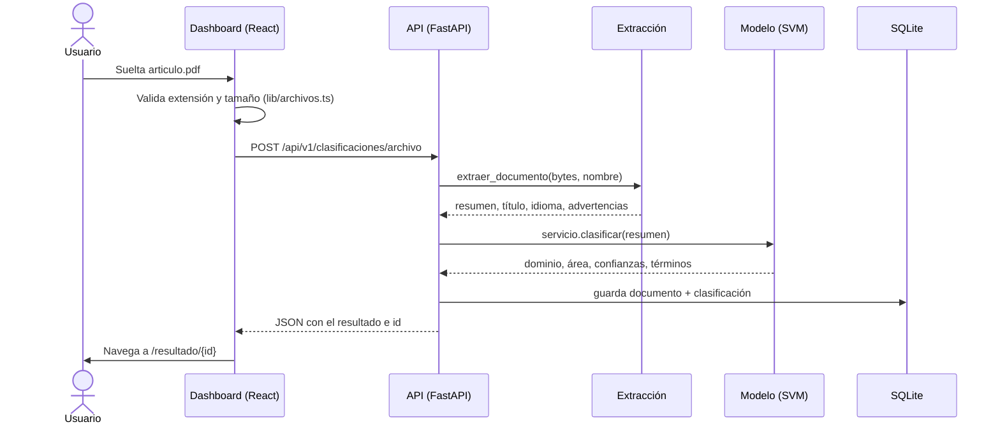
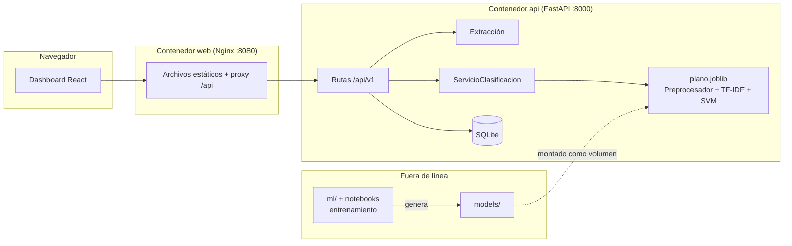
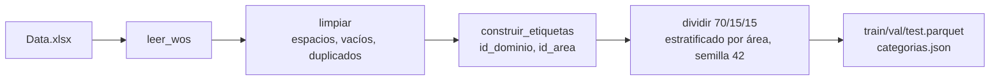
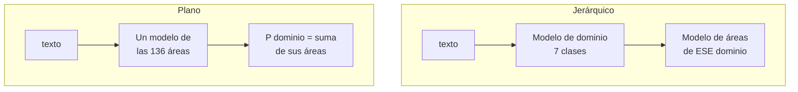
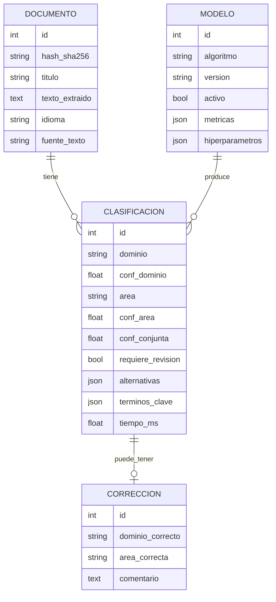

# Panorama del proyecto SICDA

Guía completa para entender **qué se construyó, cómo funciona y dónde está cada cosa en el
código**, desde el primer commit hasta la entrega. Está pensada para leerse de corrido una vez y
luego usarse como mapa. Los detalles finos de cada decisión están en los ADR
([`decisiones/`](decisiones/)) y los resultados medidos en el [informe de pruebas](pruebas.md).

## Contenido

1. [SICDA en una página](#1-sicda-en-una-página)
2. [Cómo se construyó: línea de tiempo](#2-cómo-se-construyó-línea-de-tiempo)
3. [Recorrido completo de una clasificación](#3-recorrido-completo-de-una-clasificación)
4. [Arquitectura y mapa del repositorio](#4-arquitectura-y-mapa-del-repositorio)
5. [Fase I: los datos](#5-fase-i-los-datos)
6. [Fase II: extracción y preprocesamiento del texto](#6-fase-ii-extracción-y-preprocesamiento-del-texto)
7. [Fase III: los modelos](#7-fase-iii-los-modelos)
8. [Fase IV: la API](#8-fase-iv-la-api)
9. [Fase IV: el dashboard](#9-fase-iv-el-dashboard)
10. [Fase IV: Docker y despliegue](#10-fase-iv-docker-y-despliegue)
11. [Fase V: pruebas y calidad](#11-fase-v-pruebas-y-calidad)
12. [Comandos de uso diario](#12-comandos-de-uso-diario)
13. [Decisiones clave y por qué](#13-decisiones-clave-y-por-qué)
14. [Limitaciones y trabajo futuro](#14-limitaciones-y-trabajo-futuro)
15. [Preguntas probables en la sustentación](#15-preguntas-probables-en-la-sustentación)
16. [Glosario](#16-glosario)

---

## 1. SICDA en una página

**Problema.** Clasificar documentos académicos a mano es lento. SICDA recibe un documento y
dice automáticamente a qué **dominio** (disciplina general) y a qué **área temática**
(subtema dentro del dominio) pertenece.

**Entrada.** Un PDF, DOCX o TXT de hasta 10 MB, o un título y un resumen pegados. En inglés.

**Salida.**

- Dominio (7 posibles, por ejemplo *Computer Science*) y área (136 posibles, por ejemplo
  *Computer vision*), cada uno con su confianza.
- Las 3 alternativas más probables de cada nivel.
- La **confianza conjunta** = P(dominio) × P(área | dominio).
- Una marca **«requiere revisión»** si la confianza es baja.
- Los **términos que más pesaron** en la decisión (explicabilidad).
- Advertencias: idioma distinto del inglés o resumen no encontrado.

**Cómo lo hace.** Extrae el resumen del documento, lo limpia con PLN (minúsculas, sin
puntuación, lematización con spaCy, sin palabras vacías), lo convierte en un vector TF-IDF y
lo pasa por un **SVM lineal calibrado** entrenado con 32.888 resúmenes del dataset
**Web of Science WOS-46985**.

**Qué tan bien.** En el conjunto de prueba (7.048 documentos nunca vistos): F1-macro de
**0,91 en dominio** y **0,79 en área** (metas: 0,85 y 0,65). Responde en unos **0,2 s**.

**Piezas.**

| Pieza | Tecnología | Carpeta |
| --- | --- | --- |
| Paquete de aprendizaje automático | Python 3.12, scikit-learn, spaCy, NLTK | `ml/` |
| API REST | FastAPI, SQLAlchemy, SQLite, PyMuPDF, python-docx, langdetect | `backend/` |
| Dashboard | React 19, TypeScript, Vite, Tailwind, Recharts | `frontend/` |
| Despliegue | Docker Compose (API + Nginx) | raíz |
| Calidad | pytest, Vitest, Playwright, ruff, oxlint, GitHub Actions | `*/tests`, `tests/`, `.github/` |

---

## 2. Cómo se construyó: línea de tiempo

El trabajo siguió las **5 fases de la propuesta**. Cada parte se hizo en una rama propia
desde `develop` y entró por *pull request* (PR) con el CI en verde.

| Fecha | PR | Qué entró |
| --- | --- | --- |
| 14 nov | #1 | **Fase I.** Carga, limpieza, etiquetas y partición 70/15/15 de WOS-46985 (`datos.py`, notebook 01, ADR 0002) |
| 15 nov | #2, #3 | Nombre SICDA y autor único |
| 15 nov | #4 | **Fase II.** Extracción de PDF/DOCX/TXT (backend) y preprocesamiento (ML), notebook 02 |
| 18 nov | #5 | **Fase III (1/4).** Métricas por nivel y accuracy jerárquica (`evaluacion.py`) |
| 18 nov | #6 | **Fase III (2/4).** Clasificadores jerárquico y plano (`jerarquico.py`) |
| 18 nov | #7 | **Fase III (3/4).** Búsqueda de hiperparámetros, calibración y artefactos (`entrenamiento.py`, `busqueda.py`) |
| 18 nov | #8 | **Fase III (4/4).** Notebooks 03 (clásicos), 04 (DistilBERT en Colab) y 05 (comparación) |
| 19 nov | #9 | **Fase IV.** Base de datos con SQLAlchemy |
| 20 nov | #10 | Cierre de la Fase III: elección del SVM plano (ADR 0003) |
| 20 nov | #11–#13 | API: clasificar, historial, corrección, categorías, modelos y métricas |
| 20 nov | #14 | Dashboard con las 4 vistas |
| 21 nov | #15 | `docker compose up` verificado; versiones fijadas para cargar los `.joblib` |
| 21 nov | #16 | **Fase V.** CI exige cobertura ≥ 70 % en backend, ML y frontend |
| 21 nov | #17 | Pruebas de extremo a extremo con Playwright (Chromium y Firefox) |
| 21 nov | #18 | Evaluación con 30 artículos reales de arXiv y PubMed |
| 25 nov | #19 | Prueba de rendimiento (RNF-01) |
| 25 nov | #20 | Se registra que la prueba de usabilidad se omite |
| 26 nov | #21 | Ícono SVG en la zona de arrastrar y soltar |
| 26 nov | #22 | Instrucciones para ejecutar en otra máquina y release `modelos-v1.0.0` |

---

## 3. Recorrido completo de una clasificación

Esta es la mejor forma de entender el sistema: seguir un PDF desde que el usuario lo suelta
en el navegador hasta que ve el resultado.



Paso a paso, con el archivo donde ocurre cada cosa:

1. **El usuario suelta el archivo** en la vista Clasificar
   (`frontend/src/pages/Clasificar.tsx`, componente `ZonaArchivo.tsx`). El navegador
   comprueba extensión y tamaño antes de enviarlo (`lib/archivos.ts`).
2. **El dashboard llama a la API** con `fetch('/api/v1/clasificaciones/archivo')`
   (`api/cliente.ts`). La ruta es relativa: en desarrollo la redirige Vite y en Docker Nginx.
   Mientras espera, muestra las etapas (`ProgresoEtapas.tsx`).
3. **La API recibe el archivo** en `clasificar_archivo`
   (`backend/app/api/v1/endpoints/clasificaciones.py`) y calcula su **hash SHA-256**.
4. **Extracción** (`backend/app/extraccion/`):
   - `lectores.py` valida el formato y lee el texto. En un PDF lee hasta 30 páginas con
     PyMuPDF y quita encabezados y pies repetidos (líneas que aparecen en al menos la mitad
     de las páginas). Une palabras cortadas con guion al final de línea.
   - `resumen.py` busca el encabezado *Abstract* (también «A B S T R A C T», *Summary*,
     *Resumen*), toma el texto hasta *Keywords* o *Introduction*, y extrae las palabras
     clave y el título. Si no hay encabezado, usa los primeros 300 términos; si el texto es
     corto (un resumen pegado), lo usa entero.
   - `idioma.py` detecta el idioma con langdetect.
   - `servicio.py` arma el `ResultadoExtraccion`, rechaza textos con menos de 20 términos
     (`TEXTO_INSUFICIENTE`) y agrega advertencias (`RESUMEN_NO_ENCONTRADO`,
     `IDIOMA_NO_SOPORTADO`).
5. **Clasificación** (`backend/app/clasificacion/servicio.py`): `ServicioClasificacion`
   tiene el modelo cargado en memoria desde el arranque. Llama a `predecir_detallado`, que:
   1. preprocesa el texto con el mismo `Preprocesador` del entrenamiento (va **dentro** del
      `.joblib`);
   2. lo convierte en vector TF-IDF;
   3. obtiene la probabilidad de cada una de las 136 áreas con el SVM calibrado;
   4. suma las áreas de cada dominio para obtener P(dominio), elige el dominio y luego el
      área más probable **dentro** de ese dominio;
   5. calcula la confianza conjunta y aplica los umbrales de revisión (0,65 y 0,50);
   6. calcula los términos clave (peso TF-IDF × coeficiente del SVM).
6. **Persistencia** (`backend/app/db/repositorios.py`): busca el documento por su hash (si ya
   existía no lo duplica), crea la fila `clasificacion` con todas las confianzas,
   alternativas, términos y advertencias, y confirma la transacción.
7. **Respuesta**: JSON con `id`, `documento`, `dominio`, `area`, `confianza_conjunta`,
   `requiere_revision`, `terminos_clave`, `advertencias`, `modelo` y `tiempo_ms`
   (`backend/app/schemas/clasificacion.py`).
8. **El dashboard navega a `/resultado/{id}`** (`pages/Resultado.tsx`), que vuelve a pedir
   `GET /clasificaciones/{id}` y pinta las tarjetas, las barras de alternativas, los
   términos y el texto leído con esos términos resaltados (`lib/resaltado.ts`).
9. **Si el usuario corrige** («¿No es correcto?», `FormularioCorreccion.tsx`), se envía
   `POST /clasificaciones/{id}/correccion` y se guarda en la tabla `correccion`. El modelo
   no cambia; las correcciones quedan para un reentrenamiento futuro.

---

## 4. Arquitectura y mapa del repositorio



La regla principal: **el entrenamiento ocurre fuera de línea**. La API solo carga un modelo ya
entrenado al iniciar y nunca entrena durante una consulta (RNF-03). El paquete `ml/` lo usan
tanto el entrenamiento como la API, así el texto se procesa exactamente igual en los dos.

```text
clasificador-academico/
├── ml/                          # paquete clasificador_ml (instalado en modo editable)
│   ├── configs/                 # base.yaml + un YAML por modelo
│   ├── src/clasificador_ml/     # datos, preprocesamiento, entrenamiento, evaluación...
│   └── tests/
├── backend/                     # API (paquete app)
│   ├── app/
│   │   ├── main.py              # crea la app y carga el modelo al iniciar
│   │   ├── core/config.py       # configuración por variables de entorno
│   │   ├── api/                 # rutas, dependencias y formato de errores
│   │   ├── extraccion/          # PDF/DOCX/TXT → resumen
│   │   ├── clasificacion/       # modelo activo, catálogo y métricas
│   │   ├── db/                  # tablas y consultas (SQLAlchemy)
│   │   └── schemas/             # contratos JSON (Pydantic)
│   ├── tests/
│   ├── Dockerfile
│   └── restricciones-docker.txt # versiones fijadas para cargar los .joblib
├── frontend/                    # dashboard
│   ├── src/{api,components,lib,pages}/
│   ├── Dockerfile, nginx.conf
├── notebooks/                   # 01 a 05 (exploración, preprocesamiento, modelos, Colab, comparación)
├── tests/e2e/                   # Playwright
├── tests/rendimiento/           # medición de RNF-01
├── scripts/                     # configurar entorno y empaquetar modelos
├── docs/                        # ADR, informe de pruebas y este documento
├── data/                        # (no versionado) dataset y particiones
├── models/                      # (no versionado) modelos entrenados
└── docker-compose.yml
```

`data/` y `models/` no van en Git por su tamaño. Para usar el sistema sin entrenar, se
descargan del release [`modelos-v1.0.0`](https://github.com/ElkinAcevedo/sicda/releases/tag/modelos-v1.0.0)
(ver el README).

---

## 5. Fase I: los datos

**Código:** `ml/src/clasificador_ml/datos.py` · **Notebook:** 01 · **Decisión:** ADR 0002.

**El dataset.** WOS-46985 (Kowsari et al., 2017): 46.985 resúmenes de Web of Science en
inglés, cada uno con palabras clave, un dominio (`Y1`, 7 clases) y un área (`Y`, 134 en la
versión original).

**El problema que se encontró.** Las etiquetas de área no eran consistentes con la jerarquía:

- Tres áreas aparecían en dos dominios: *Depression*, *Schizophrenia* y *Anxiety* estaban
  tanto en Psychology como en Medical.
- Un identificador mezclaba *Anxiety* (Medical) con *Bamboo as a Building Material* (Civil,
  2 documentos).
- Varios nombres tenían variantes («Smart Material», «Nano Concrete»…) y espacios sobrantes.

**La solución (ADR 0002).** El área se define como el **par (dominio, área original)**,
renumerado como `id_area`. Así *Depression* de Psychology y *Depression* de Medical son dos
áreas distintas, cada una con un único dominio padre. Se descartan las áreas con menos de 10
documentos (solo una, con 2). Resultado: **46.983 documentos, 7 dominios y 136 áreas** (de
ahí que el diseño diga 134 y el sistema 136).

**El flujo** (`python -m clasificador_ml.datos`, unos 7 s):



| Partición | Documentos | Para qué se usa |
| --- | --- | --- |
| `train` | 32.888 | Entrenar y buscar hiperparámetros (validación cruzada interna) |
| `val` | 7.047 | Comparar modelos y calibrar los umbrales de revisión |
| `test` | 7.048 | Medir el modelo elegido **una sola vez**, al final |

Columnas: `id_documento, texto, palabras_clave, id_dominio, dominio, id_area, area,
y_original`. `categorias.json` guarda la jerarquía con nombres, alias y número de documentos
de cada área; lo usan la API y el dashboard.

---

## 6. Fase II: extracción y preprocesamiento del texto

Son dos cosas distintas que viven en lugares distintos:

| | Extracción | Preprocesamiento |
| --- | --- | --- |
| **Qué hace** | Saca el resumen del archivo | Limpia el resumen para el modelo |
| **Dónde** | `backend/app/extraccion/` | `ml/src/clasificador_ml/preprocesamiento.py` |
| **Cuándo** | Solo en la API | En el entrenamiento **y** en la API (va dentro del modelo) |

### 6.1 Extracción (backend)

Se explicó en el [recorrido](#3-recorrido-completo-de-una-clasificación). Puntos a recordar:

- **Formatos:** PDF con texto seleccionable (no hay OCR), DOCX y TXT.
- **Errores** (`extraccion/errores.py`), cada uno con su código HTTP:

  | Código | HTTP | Cuándo |
  | --- | --- | --- |
  | `FORMATO_NO_SOPORTADO` | 415 | Extensión distinta de .pdf, .docx o .txt |
  | `ARCHIVO_MUY_GRANDE` | 413 | Más de 10 MB |
  | `ARCHIVO_DANADO` | 422 | El archivo no se puede abrir (agregado propio) |
  | `TEXTO_INSUFICIENTE` | 422 | Vacío, PDF escaneado o menos de 20 términos |

- **`fuente_texto`** indica de dónde salió el texto: `abstract` (se encontró el encabezado),
  `inicio` (primeros 300 términos) o `texto_completo` (texto corto, usado entero).
- Si hay resumen en español y en inglés, se prefiere el inglés.

### 6.2 Preprocesamiento (ML)

`Preprocesador` es un transformador de scikit-learn con cuatro pasos:

1. **`normalizar`:** Unicode NFKD sin tildes y minúsculas; quita URL, correos, números y
   puntuación (solo quedan letras a–z).
2. **Lematizar** con spaCy `en_core_web_sm` (sin parser ni NER, para ir rápido):
   «networks» → «network», «proposed» → «propose».
3. **Quitar *stopwords*** de NLTK («the», «of», «we»…) comparando la palabra y su lema.
4. Quitar tokens de menos de 2 letras.

Se lematiza **antes** de quitar las *stopwords* para que spaCy vea la frase completa.

**Por qué es un transformador de scikit-learn:** porque así se guarda dentro del pipeline
del modelo (`Pipeline(Preprocesador, TF-IDF, SVM)`). La API le pasa el texto crudo al modelo
y este lo procesa igual que en el entrenamiento; es imposible que se desincronicen.

**Atajo para entrenar:** lematizar 47.000 resúmenes tarda unos 2,5 minutos, así que
`python -m clasificador_ml.preprocesamiento --procesos 4` los procesa una vez y guarda la
columna `texto_procesado` en `data/processed/preprocesado/`. El entrenamiento usa esa columna
y, al publicar, se antepone el `Preprocesador` al pipeline.

DistilBERT usa solo `normalizar`, porque su tokenizador necesita las palabras completas.

---

## 7. Fase III: los modelos

**Código:** `ml/src/clasificador_ml/{entrenamiento,busqueda,jerarquico,evaluacion,seleccion,artefactos}.py`
· **Notebooks:** 03, 04, 05 · **Decisión:** ADR 0003.

### 7.1 Representación: TF-IDF

Cada resumen se convierte en un vector de hasta 100.000 dimensiones, una por término
(palabra o par de palabras). El peso de un término es alto si aparece mucho en ese resumen y
poco en el resto del corpus. Configuración (`ml/configs/base.yaml`):

| Parámetro | Valor | Significado |
| --- | --- | --- |
| `ngram_range` | (1, 2) | Palabras sueltas y pares («neural network») |
| `min_df` | 3 | Ignora términos que aparecen en menos de 3 documentos |
| `max_df` | 0,9 | Ignora términos que aparecen en más del 90 % |
| `max_features` | 100.000 | Tamaño máximo del vocabulario |
| `sublinear_tf` | sí | Usa 1 + log(frecuencia) para que repetir una palabra no domine |

### 7.2 Los tres algoritmos

| Algoritmo | Idea | Configuración |
| --- | --- | --- |
| **Complement Naive Bayes** (línea base) | Probabilidades por conteo de palabras; la variante «complement» funciona mejor con clases desbalanceadas | `alpha` ∈ {0,1; 0,3; 1,0} → elegido 1,0 |
| **SVM lineal** (`LinearSVC`) | Busca el hiperplano que separa las clases con el mayor margen; ideal para texto disperso | `C` ∈ {0,1; 0,5; 1; 2}, `class_weight=balanced` → elegido 1,0 |
| **DistilBERT** | Transformer preentrenado, ajustado (*fine-tuning*) con los resúmenes | 256 tokens, 3 épocas, lote 32, lr 5e-5; en Google Colab con GPU T4 (11 min) |

**Búsqueda de hiperparámetros** (`busqueda.py`, clase `BusquedaYCalibracion`): `GridSearchCV`
con validación cruzada estratificada de 5 particiones sobre `train`, optimizando F1-macro.

**Calibración:** el SVM no da probabilidades, solo distancias al hiperplano. Se calibran con
`CalibratedClassifierCV` (método sigmoide de Platt) **solo para el mejor `C`**. Naive Bayes
también se calibra, porque sus probabilidades son casi uniformes (máximo ≈ 0,014 entre 136
áreas) y no sirven como confianza. Sin probabilidades calibradas no tendría sentido el umbral
de «requiere revisión».

> `BusquedaYCalibracion` está en su propio módulo por un detalle técnico: si estuviera en
> `entrenamiento.py`, que se ejecuta con `python -m`, el `.joblib` la guardaría como
> `__main__.BusquedaYCalibracion` y la API no podría cargarla.

### 7.3 Jerárquico frente a plano

Se probaron dos formas de organizar la clasificación (`jerarquico.py`):



- **Jerárquico** (`ClasificadorJerarquico`): 1 modelo de dominio + 7 modelos de área, uno por
  dominio, cada uno entrenado solo con los documentos de su dominio (8 modelos por
  algoritmo; Medical tiene 55 áreas).
- **Plano** (`ClasificadorPlano`): 1 modelo de las 136 áreas. P(dominio) se obtiene sumando
  las probabilidades de las áreas de ese dominio, y P(área | dominio) = P(área) / P(dominio)
  (`condicional_desde_plano`).

Los dos comparten la misma **decodificación** (`decodificar`):

1. Dominio = el de mayor P(dominio).
2. Área = la de mayor P(área | dominio) **dentro del dominio elegido**, así el par siempre es
   coherente (nunca sale «Psychology → Computer vision»).
3. Confianza conjunta = P(dominio) × P(área | dominio).
4. «Requiere revisión» si P(dominio) < umbral de dominio **o** conjunta < umbral conjunto.

Como el área siempre está dentro del dominio predicho, el F1 jerárquico (aciertan los dos
niveles) coincide con el F1 de área.

### 7.4 Resultados y elección

Comparación en validación (`notebooks/05-comparacion-modelos.ipynb`):

| Modelo | F1 dominio | F1 área | ms por resumen |
| --- | --- | --- | --- |
| **SVM plano** | 0,902 | **0,781** | 215 |
| DistilBERT plano | **0,908** | 0,769 | 233 |
| SVM jerárquico | 0,878 | 0,751 | 79 |
| NB plano | 0,856 | 0,720 | 203 |
| NB jerárquico | 0,801 | 0,642 | 76 |

**Regla de selección** (fijada en el diseño, `seleccion.py`): mayor F1-macro jerárquico en
validación; si otro queda a menos de 2 puntos y es más rápido, gana el más rápido.

**Ganó el SVM plano:** tiene el mejor F1 de área. DistilBERT queda a 1,2 puntos pero es más
lento en CPU, pesa unos 260 MB y obligaría a instalar PyTorch en la API. El jerárquico es
más rápido, pero queda a 3 puntos, fuera del margen.

**¿Por qué el plano gana al jerárquico?** Cada submodelo de área del jerárquico aprende con
pocos datos (solo los de su dominio) y un error de dominio arrastra el área. El plano ve
todos los datos a la vez y, al imponer la jerarquía en la decodificación, igual da pares
coherentes.

**Umbrales de revisión:** se calibraron en validación (`curva_revision` y `elegir_umbrales`)
buscando la combinación que manda **menos** documentos a revisión con una accuracy ≥ 0,90 en
los aceptados. Quedaron **0,65 (dominio) y 0,50 (conjunta)**, frente a 0,60 / 0,40 del
diseño, que solo daban 0,875. Con ellos se va a revisión el 24 % de los documentos y se
atrapan casi dos de cada tres errores.

**Evaluación final en test** (una sola vez): F1 dominio **0,910**, F1 área **0,791**,
accuracy jerárquica 0,805.

### 7.5 Explicabilidad

`terminos_clave` (`jerarquico.py`) toma el vector TF-IDF del texto, lo multiplica término a
término por los coeficientes del SVM para la clase predicha y devuelve los de mayor
contribución positiva. Son las palabras del propio texto que más empujaron hacia esa
categoría. El dashboard las muestra como etiquetas y las resalta en el resumen.

### 7.6 Artefactos (RNF-08)

Cada entrenamiento crea `models/<algoritmo>/<AAAAMMDD-HHMM>/` con:

| Archivo | Contenido |
| --- | --- |
| `plano.joblib`, `jerarquico.joblib` | Modelos listos para la API (incluyen el `Preprocesador`) |
| `metadatos.json` | Versión, configuración, mejores hiperparámetros, métricas de validación y tiempos |
| `predicciones_val_<tipo>.parquet` | Predicciones de validación, para comparar y calibrar |
| `predicciones_test_plano.parquet`, `evaluacion_test_plano.json` | Solo el modelo elegido |

DistilBERT (Colab) exporta `probabilidades_{val,test}.parquet` y se evalúa con la misma
decodificación (`predicciones_desde_probabilidades`).

`models/activo.json` dice **qué modelo carga la API**, con sus umbrales y sus métricas de test.
Lo escribe `publicar_activo` (`artefactos.py`) desde el notebook 05.

Para reentrenar: `python -m clasificador_ml.entrenamiento --config ml/configs/svm.yaml` y luego
el notebook 05.

---

## 8. Fase IV: la API

**Código:** `backend/app/`. Documentación interactiva en <http://localhost:8000/docs>.

### 8.1 Arranque (`main.py`)

Al iniciar, `ciclo_de_vida`:

1. Crea las tablas que falten en SQLite.
2. Carga el modelo activo **una sola vez** (`cargar_servicio`). Si falla, la API arranca igual
   y los endpoints de clasificación responden `503 MODELO_NO_DISPONIBLE`.
3. Carga el catálogo de categorías (`categorias.json`).
4. Registra en la tabla `modelo` los modelos que hay en `models/` (`registro.py`), para que el
   panel de métricas pueda compararlos.

**Configuración** (`core/config.py`): todo se puede cambiar con variables
`CLASIFICADOR_<NOMBRE>`, por ejemplo `CLASIFICADOR_RUTA_MODELOS` o
`CLASIFICADOR_URL_BASE_DATOS`. Así Docker apunta a `/srv/models` sin tocar el código.

### 8.2 Endpoints (`/api/v1`)

| Método y ruta | Archivo | Qué hace |
| --- | --- | --- |
| `GET /salud` | `endpoints/salud.py` | Estado y modelo activo |
| `GET /categorias` | `endpoints/modelos.py` | Los 7 dominios y sus 136 áreas |
| `POST /clasificaciones/archivo` | `endpoints/clasificaciones.py` | Clasifica un archivo (multipart) |
| `POST /clasificaciones/texto` | ídem | Clasifica `{titulo, texto}` |
| `GET /clasificaciones` | ídem | Historial paginado con filtros `dominio`, `desde`, `hasta`, `requiere_revision` y búsqueda |
| `GET /clasificaciones/{id}` | ídem | Detalle de una clasificación |
| `POST /clasificaciones/{id}/correccion` | ídem | Guarda la corrección del usuario |
| `GET /modelos` | `endpoints/modelos.py` | Modelos registrados (primero el activo) con métricas resumidas |
| `GET /modelos/{id}/metricas` | ídem | Métricas por clase y matrices de confusión, en validación o prueba |

**Errores** (`api/errores.py`): todos con el formato `{"error": {"codigo", "mensaje"}}`. Además
de los de extracción: `ENTRADA_INVALIDA` 400, `NO_ENCONTRADO` 404, `MODELO_NO_DISPONIBLE` y
`CATEGORIAS_NO_DISPONIBLES` 503.

**Dependencias** (`api/dependencias.py`): FastAPI inyecta en cada endpoint la sesión de base
de datos, el servicio de clasificación y el catálogo; si falta el modelo, la dependencia
responde 503 antes de entrar al endpoint.

### 8.3 Base de datos (`db/`)



- **`documento`**: lo que el usuario cargó. El hash SHA-256 evita guardar dos veces el mismo
  contenido; si se vuelve a clasificar, se crea otra `clasificacion` sobre el mismo
  documento.
- **`clasificacion`**: guarda todo lo necesario para reconstruir la respuesta sin volver a
  clasificar.
- **`modelo`**: un registro por modelo entrenado; solo uno con `activo = true`. Los
  artefactos viven en `models/`, no en la base.
- **`correccion`**: la retroalimentación del usuario (RF-12).

`repositorios.py` tiene todas las consultas, sin lógica HTTP; `sesion.py` crea una sesión por
solicitud.

### 8.4 Métricas para el panel (`clasificacion/registro.py`)

`CalculadoraMetricas` no reentrena nada: lee las predicciones guardadas en `models/` y
calcula con `clasificador_ml.evaluacion` las métricas por clase, la matriz de confusión de
dominios y las de áreas por dominio. Las métricas de **prueba** solo existen para el modelo
activo (el test se usa una sola vez); los demás se muestran en validación.

---

## 9. Fase IV: el dashboard

**Código:** `frontend/src/`. React 19 + TypeScript, compilado con Vite y estilado con
Tailwind.

### 9.1 Vistas (`pages/`)

| Ruta | Vista | Qué muestra |
| --- | --- | --- |
| `/` | `Clasificar.tsx` | Pestañas «Subir archivo» y «Pegar texto», botón «Probar con un ejemplo» y las últimas 5 clasificaciones |
| `/resultado/:id` | `Resultado.tsx` | Tarjetas de dominio y área, confianza conjunta, alternativas, términos clave, texto leído con resaltado, avisos y corrección |
| `/historial` | `Historial.tsx` | Tabla paginada con búsqueda y filtros por dominio, estado y fechas |
| `/metricas` | `Metricas.tsx` | Indicadores del modelo, gráfico comparativo, matriz de confusión interactiva, F1 por área y distribución del dataset |

`Metricas` se carga de forma diferida (`lazy`) porque incluye la librería de gráficos.

### 9.2 Piezas compartidas

| Carpeta | Contenido |
| --- | --- |
| `api/cliente.ts`, `api/tipos.ts` | Funciones para cada endpoint y los tipos de las respuestas. `ErrorApi` convierte el formato de error del contrato en una excepción |
| `components/Layout.tsx` | Barra lateral con el menú, el modo claro/oscuro y el estado de la API |
| `components/ui.tsx` | Tarjetas, botones, barras de confianza, avisos, estados de carga y error |
| `components/` | `ZonaArchivo`, `ProgresoEtapas`, `FormularioCorreccion`, `MatrizConfusion`, `TablaAreas`, `iconos` |
| `lib/hooks.ts` | `useCarga` (pedir datos con estado de carga y error), `useCategorias` y `useTema` |
| `lib/formato.ts` | Porcentajes, fechas, colores por dominio y niveles de confianza |
| `lib/resaltado.ts` | Marca en el texto las palabras de los términos clave |
| `lib/errores.ts` | Mensajes amigables para cada código de error |

**El frontend nunca escribe la URL del backend:** llama a `/api/v1/...` y quien redirige es
Vite en desarrollo (`vite.config.ts`) o Nginx en Docker (`nginx.conf`).

---

## 10. Fase IV: Docker y despliegue

`docker compose up --build` levanta dos contenedores:

| Servicio | Imagen | Puerto | Qué hace |
| --- | --- | --- | --- |
| `api` | `backend/Dockerfile` (Python 3.12 slim) | 8000 | Instala `ml/` y `backend/`, descarga spaCy y las stopwords, y ejecuta Uvicorn |
| `web` | `frontend/Dockerfile` (Node para compilar → Nginx para servir) | 8080 | Sirve el dashboard compilado y redirige `/api/` al contenedor `api` |

- `models/` y `data/processed/` se montan como **volúmenes de solo lectura**; no van dentro de
  la imagen.
- La base SQLite vive en el volumen `datos_api`, así el historial sobrevive a reinicios
  (`docker compose down -v` lo borra).
- `backend/restricciones-docker.txt` fija las versiones de scikit-learn y compañía: un
  `.joblib` solo carga bien con las mismas versiones con que se entrenó.

**Para otra máquina:** clonar, descargar `sicda-modelos-v1.0.0.zip` del release, descomprimirlo
en la raíz y ejecutar `docker compose up --build` (detalles en el README). El paquete lo genera
`scripts/empaquetar_modelos.sh`.

---

## 11. Fase V: pruebas y calidad

| Tipo | Dónde | Resultado |
| --- | --- | --- |
| Unitarias ML | `ml/tests/` (pytest) | 80 pruebas, 95 % de cobertura |
| Unitarias e integración API | `backend/tests/` (pytest + cliente de FastAPI) | 144 pruebas, 99 % de cobertura |
| Frontend | `frontend/src/**/*.test.tsx` (Vitest + Testing Library) | 40 pruebas, 95 % de líneas |
| Extremo a extremo | `tests/e2e/` (Playwright) | 6 de 6 en Chromium y Firefox |
| Rendimiento | `tests/rendimiento/rendimiento.py` (httpx) | p95 de 0,23 s (meta < 2 s y < 5 s) |
| Artículos externos | `clasificador_ml/externos.py` | 30 artículos de arXiv/PubMed: F1 0,97 y 0,81 |
| Usabilidad | — | **No realizada** (RNF-04 sin verificar) |

**Cómo se aíslan las pruebas:** en el CI no existen `models/` ni `data/`.
`backend/tests/conftest.py` reemplaza el modelo y la base por dobles de prueba, y las pruebas
e2e entrenan un SVM diminuto con datos sintéticos usando el propio código del proyecto. Así
todo corre igual en local y en GitHub Actions.

**CI** (`.github/workflows/ci.yml`), en cada *push* y PR, con tres trabajos:

1. **Backend y ML:** `ruff`, pytest del paquete ML, del backend y del script de rendimiento.
2. **Frontend:** `oxlint`, Vitest con cobertura y compilación.
3. **Extremo a extremo:** levanta API y dashboard reales y corre Playwright en dos navegadores.

Si cualquier parte baja del 70 % de cobertura, el CI falla (RNF-07).

**Artículos externos** (`externos.py`): descarga candidatos de arXiv y PubMed publicados desde
2020 (no pueden estar en WOS, que es de 2017), los deja en un Excel para revisión humana y
luego los clasifica. Sirve para comprobar que el modelo generaliza fuera del dataset.

---

## 12. Comandos de uso diario

```bash
source .venv/bin/activate                       # activar el entorno (Linux/macOS)

# Ejecutar
cd backend && uvicorn app.main:app --reload     # API → http://localhost:8000/docs
cd frontend && npm run dev                      # Dashboard → http://localhost:5173
docker compose up --build                       # todo junto → http://localhost:8080

# Datos y modelos
python -m clasificador_ml.datos                 # particiones (~7 s)
python -m clasificador_ml.preprocesamiento --procesos 4   # texto procesado (~2,5 min)
python -m clasificador_ml.entrenamiento --config ml/configs/svm.yaml
./scripts/empaquetar_modelos.sh sicda-modelos.zip

# Calidad
ruff check backend ml && ruff format --check backend ml
pytest ml/tests
cd backend && pytest --cov=app
cd frontend && npm run lint && npm run test:cobertura
cd tests/e2e && npm test
python tests/rendimiento/rendimiento.py         # con la API corriendo
```

---

## 13. Decisiones clave y por qué

| Decisión | Por qué | Dónde |
| --- | --- | --- |
| Área = par (dominio, área original), 136 áreas | Las etiquetas originales tenían áreas con dos dominios padre | ADR 0002 |
| Partición 70/15/15 estratificada, semilla 42 | Todas las áreas representadas en las tres partes; reproducible | `base.yaml` |
| Test usado una sola vez | Evitar elegir el modelo «mirando» el test, lo que inflaría el resultado | ADR 0003 |
| `Preprocesador` dentro del `.joblib` | Que la API procese el texto exactamente igual que el entrenamiento | `preprocesamiento.py` |
| Calibrar SVM y NB | La confianza y el umbral de revisión necesitan probabilidades reales | `busqueda.py` |
| SVM plano sobre DistilBERT | Mejor F1 de área, más rápido en CPU, sin GPU ni PyTorch | ADR 0003 |
| Plano sobre jerárquico | 3 puntos más de F1; la jerarquía se impone al decodificar | ADR 0003 |
| Umbrales 0,65 / 0,50 | Menos revisión posible con accuracy ≥ 0,90 en los aceptados | notebook 05 |
| SQLite | Un solo archivo, sin servidor; suficiente para un usuario | ADR 0001 |
| FastAPI | Validación con Pydantic y documentación OpenAPI automática | ADR 0001 |
| El frontend solo habla con la API por rutas relativas | Mismo código en desarrollo y en Docker | `vite.config.ts`, `nginx.conf` |
| Versiones fijadas en Docker | Un `.joblib` puede fallar con otra versión de scikit-learn | `restricciones-docker.txt` |
| `models/` y `data/` fuera de Git | Pesan cientos de MB; se distribuyen por release | `.gitignore`, release |

---

## 14. Limitaciones y trabajo futuro

| Limitación | Trabajo futuro |
| --- | --- |
| Solo inglés: el dataset está en inglés y el modelo no entiende español | Modelo multilingüe o dataset en español |
| Sin OCR: los PDF escaneados no se leen | Agregar OCR (por ejemplo Tesseract) |
| Usabilidad sin medir (RNF-04) | Prueba con 5 a 8 usuarios y cuestionario SUS |
| Taxonomía fija de WOS (2017) | Permitir categorías propias de cada institución |
| Uno de cada cuatro documentos va a revisión | Relajar umbrales si se acepta más error; reentrenar con las correcciones |
| Evaluación externa pequeña (30 artículos, 5 dominios) | Ampliarla a más artículos y a Civil y Mechanical |
| Sin usuarios ni roles | Autenticación si se despliega para varias personas |

---

## 15. Preguntas probables en la sustentación

**¿Por qué 136 áreas y no 134?** Porque en el dataset original tres áreas estaban en dos
dominios a la vez. Se separaron por dominio para que la jerarquía fuera consistente
(ADR 0002).

**¿Por qué no ganó DistilBERT, si es el modelo más moderno?** Quedó 1,2 puntos por debajo en
F1 de área, es más lento en CPU, pesa 260 MB y exige PyTorch. Con resúmenes cortos y
vocabulario técnico muy distintivo, TF-IDF + SVM es muy competitivo.

**¿Qué significa «requiere revisión»?** Que la confianza del dominio es menor que 0,65 o la
conjunta menor que 0,50. Los umbrales se eligieron para que, en los documentos que **no** se
marcan, el sistema acierte al menos el 90 % de las veces.

**¿Cómo sabe el sistema qué palabras influyeron?** Multiplica el peso TF-IDF de cada palabra
del texto por el coeficiente que el SVM le asigna a esa palabra para la clase elegida, y
muestra las de mayor contribución.

**¿Cómo se evitó el sobreajuste?** Hiperparámetros con validación cruzada solo en `train`,
selección del modelo en `val` y medición final en `test` una sola vez. Además se probó con
30 artículos posteriores a 2020 que no pueden estar en el dataset.

**¿Qué pasa si subo un documento en español?** Se clasifica igual, pero aparece la
advertencia `IDIOMA_NO_SOPORTADO` y lo normal es que quede marcado para revisión.

**¿Qué pasa con las correcciones del usuario?** Se guardan en la tabla `correccion`. El modelo
no aprende en caliente (RNF-03); servirían para un reentrenamiento futuro.

**¿Cómo se garantiza que la API procese el texto igual que en el entrenamiento?** El
preprocesamiento es parte del pipeline guardado en el `.joblib`.

**¿Qué tan rápido es?** Mediana de 216 ms con texto y 227 ms con un PDF de 20 páginas; casi todo
el tiempo es la lematización con spaCy.

---

## 16. Glosario

| Término | Significado |
| --- | --- |
| **Dominio** | Disciplina general (7): Computer Science, ECE, Psychology, Mechanical, Civil, Medical, Biochemistry |
| **Área** | Subtema dentro de un dominio (136) |
| **TF-IDF** | Vector de pesos de términos: frecuente en el documento y raro en el corpus = peso alto |
| **Lematizar** | Llevar cada palabra a su forma base («networks» → «network») |
| ***Stopwords*** | Palabras vacías sin contenido temático («the», «of») |
| **SVM** | Máquina de vectores de soporte: separa clases con el mayor margen |
| **Calibración** | Convertir las salidas de un modelo en probabilidades fiables |
| **Precisión** | De lo que el modelo dijo que era X, cuánto era X |
| **Recall** | De todo lo que era X, cuánto encontró el modelo |
| **F1** | Media armónica de precisión y recall |
| **F1-macro** | Promedio simple del F1 de cada clase (las clases pequeñas pesan igual que las grandes) |
| **Accuracy jerárquica** | Porcentaje de documentos con dominio **y** área correctos |
| **Validación cruzada** | Entrenar y evaluar varias veces sobre particiones de `train` para elegir hiperparámetros |
| **p95** | El 95 % de las respuestas tarda menos que ese valor |
| **ADR** | *Architecture Decision Record*: documento corto con una decisión y su porqué |
| **Artefacto** | Archivo generado por el entrenamiento (modelo, metadatos, predicciones) |
| **`.joblib`** | Formato en que se guarda un modelo de scikit-learn |
| **CI** | Integración continua: GitHub Actions ejecuta lint y pruebas en cada PR |
